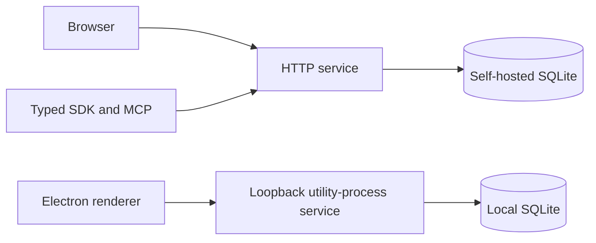

# Architecture

## Runtime modes

Parabolic shares a React/TypeScript renderer and Node service across desktop and web. The local desktop workspace is not automatically synchronized with a separate hosted database. A desktop can instead connect to a configured shared origin.

### Desktop mode

`src/desktop/main.ts` owns windows, menus, deep links and lifecycle. The preload exposes a constrained IPC bridge. `service-process.ts` starts `service.cjs` as an Electron utility process; the child creates the same service used by web hosting. SQLite and synchronous API work stay out of the main process.

The embedded origin uses loopback and a persisted port. The default data directory is Electron's Parabolic user-data directory, normally `~/Library/Application Support/Parabolic` on macOS. `PARABOLIC_USER_DATA` overrides it explicitly. `window-state.json` retains window/port state; `connection.json` retains a selected shared-server origin. Browser partitions retain cookies and IndexedDB data separately from SQLite.

Remote origins require HTTPS, except loopback HTTP, and cannot include credentials, path, query or fragment. Remote session partitions are scoped to the origin. Changing the desktop connection does not migrate database records between local and remote services.

### Web/service mode

`src/server/index.ts` builds `createApp()` from environment settings and starts the HTTP service. It serves compiled `dist`, REST under `/api/v1`, GraphQL at `/graphql`, SSE changes and authenticated Yjs collaboration sockets. The default bind is loopback; a shared host needs explicit public URL/origin policy and HTTPS proxying.

`src/server/database.ts` uses Node's built-in SQLite API with WAL, foreign keys, indexes and FTS. Schema setup/migration logic runs in the service. One active process owns each database; the design is not a horizontally scaled database cluster.

## Data and synchronization

| Component | Responsibility |
| --- | --- |
| `src/client` | UI, routes, editor, cached records, offline queue and conflict presentation. |
| `src/server` | Domain validation, authorization, persistence, APIs, collaboration, mail and background work. |
| `src/shared` | Shared types and domain/editor rules. |
| `src/desktop` | Native shell, restricted IPC, process supervision, restart and update handling. |
| `packages/sdk` | Typed API client and webhook utilities. |
| `src/mcp` | Stdio/HTTP JSON-RPC tools constrained by underlying API credentials. |

SQLite contains workspace records, authentication state, token hashes, webhook secrets, mail queue content, collaboration state and attachment bytes. It is sensitive even when some credentials are hashed. Database directory permissions are not database encryption.

The renderer bootstraps bounded pages and follows a sequence-based change feed. IndexedDB holds cached records and durable pending operations scoped by account/workspace. Version conflicts remain visible rather than silently replacing competing edits. Yjs handles shared rich-text changes; normal entity changes use the service change feed. Permission changes require cache/access reconciliation.

Backing up the server database does not necessarily capture unsent browser drafts/outbox operations. A recovery plan may need both service storage and client profiles, with appropriate access controls.

## Authentication and integrations

First-run setup creates an owner/workspace; there is no supplied account/password. Passwords use salted scrypt. Sessions, API tokens and OAuth app secrets use hashes in the relevant database tables; webhook signing secrets remain recoverable data and need private storage. Service authorization applies independently of client UI visibility.

Optional SMTP is provided by the mail worker, backed by a durable outbox. Provider addresses/passwords come from operator environment configuration, not this source tree. External webhook delivery is restricted by default; enabling private-network destinations changes the service's trust boundary.

Stdio MCP needs `PARABOLIC_API_TOKEN`; HTTP MCP forwards the caller's bearer authorization to the service. Collection/read-only settings further restrict tools and do not grant permissions missing from the underlying credential. Do not expose HTTP MCP publicly without a deliberate authentication/origin deployment plan.

## Build and delivery

`pnpm build` emits:

- `dist`: browser/Electron renderer and static assets.
- `dist-server/index.mjs`: shared-service entry with external runtime dependencies.
- `dist-desktop`: bundled main/preload/utility entries.
- `dist-mcp`: MCP entry.
- `packages/sdk/dist`: SDK JavaScript/type declarations.

The desktop package includes compiled renderer/desktop files and package metadata, not the user's profile/database. The web container includes compiled web/server output and production dependencies, with persistent `/data` storage. CI validates source on Linux/macOS and builds the container; it does not operate a production host or release feed.

The optional generic update feed must be HTTPS without embedded credentials/query/fragment. Enabling it requires code signing. Ad-hoc local signing is not Developer ID signing/notarization, and source publication is not a signed-update release.

## Limits

No managed Fly app, shared production host, signed installer publication, update endpoint or provider credentials are provisioned by this repository. Integration icons are not proof of implemented provider connectors. SAML/SCIM and hosted AI are outside this implementation. Some legacy direct-form intake is anonymous; see the service/API reference before hosting those routes. Unit/build success is not a claim of complete product parity or native UI validation.

Use [the runbook](DEPLOY_RUNBOOK.md) for deployment/recovery and [the inventory](ENV_AND_SECRETS.md) for configuration and credential locations.
